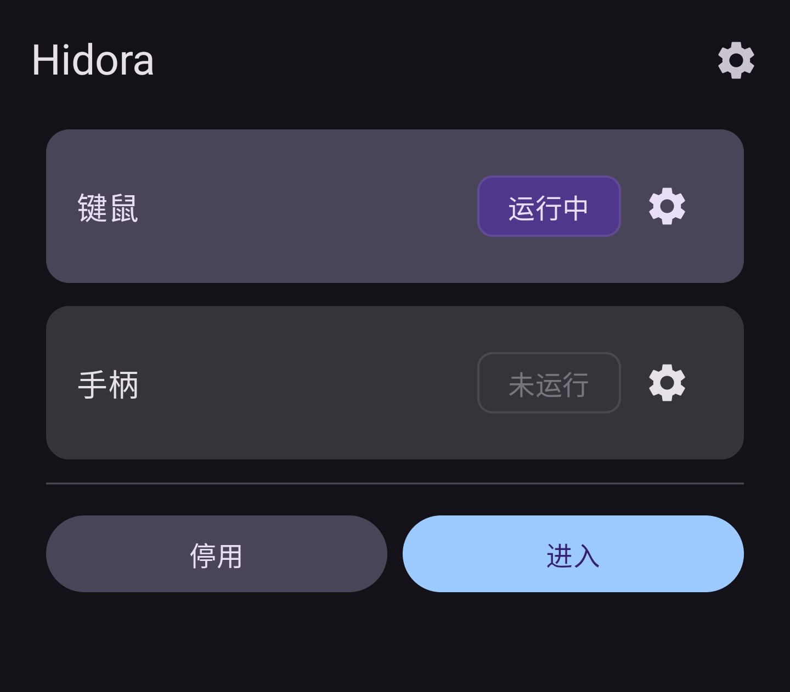
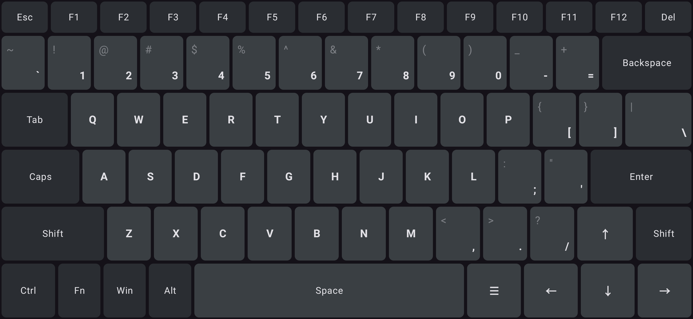
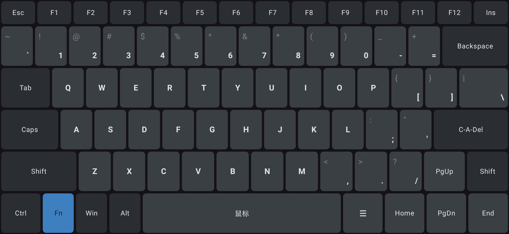
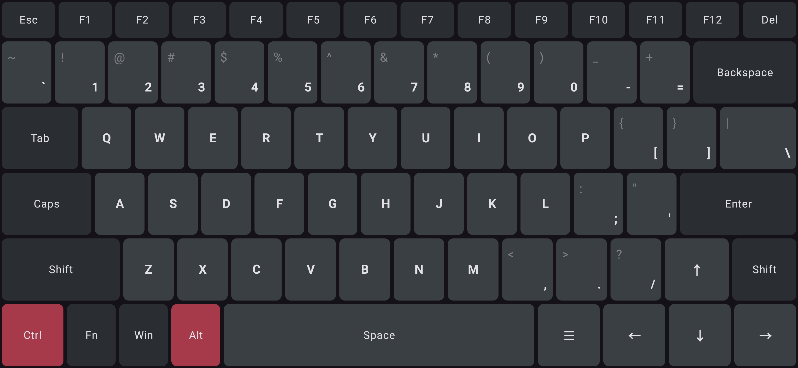
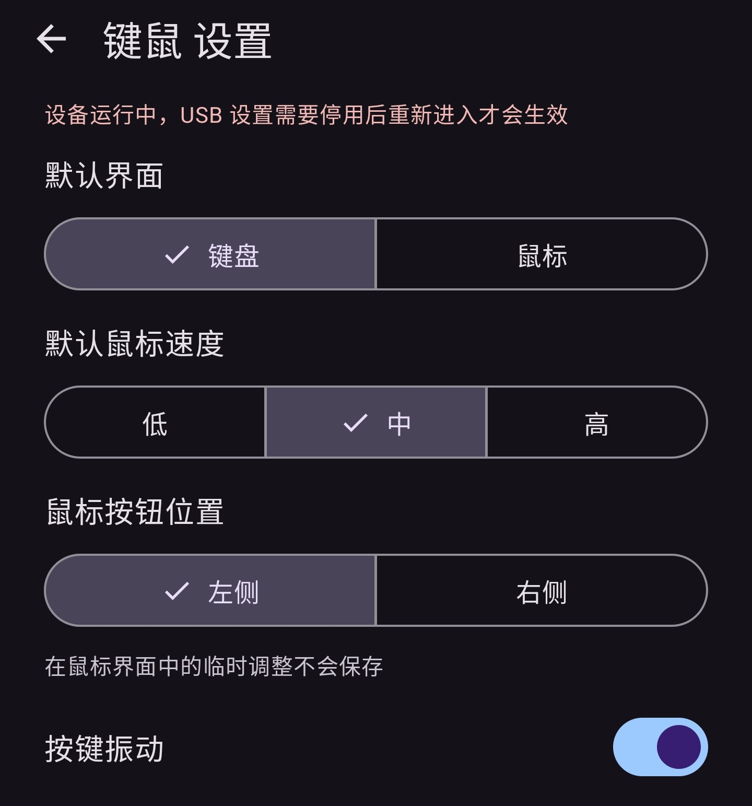
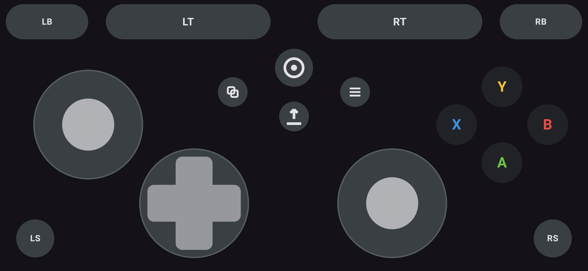
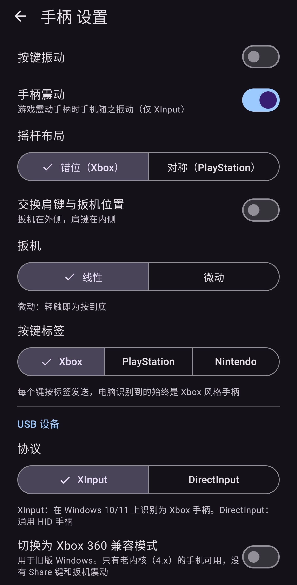

# Hidora

**使用已 root 的 Android 设备模拟多种输入设备**

---
Hidora 让已 root 的 Android 设备使用 Linux USB Gadget 功能，模拟成键盘、鼠标或游戏手柄等输入设备。  
电脑以及其他支持 USB 输入的设备可以直接使用，主机端不需要安装软件或驱动。  
基于 [Android_HID_Keyboard](https://github.com/Sucareto/Android_HID_Keyboard) 全面重构，各 USB 设备功能独立实现，后续会添加更多。

## 功能介绍

主界面：选择要模拟的设备（同一时间只能启用一种），查看运行状态，进入设备界面或停用。

### 键盘 + 鼠标

- 横屏键盘，参考 87 键布局构建，包含 Fn 功能层（Fn + 方向键为 PgUp / PgDn / Home / End，Fn + Del 为 Insert）
- 修饰键（Ctrl、Shift、Alt、Win）按住即可组合，双击锁定，再次双击解除
- Caps Lock 状态与主机同步（主机开启时按键高亮）
- 同时通过全键无冲（NKRO）和 Boot 协议两个键盘接口发送按键数据，保证兼容性
- Fn + Space 切换到鼠标界面，Fn + Enter 发送 Ctrl + Alt + Del
- 鼠标界面：左键、中键、右键，触摸板支持单指移动与双指滚动，可随时切换速度与左右手布局

界面概览：

<table>
  <tr>
    <td align="center"> 键盘</td>
    <td align="center"> Fn 功能层</td>
  </tr>
  <tr>
    <td align="center"> 双击按住 Ctrl + Alt</td>
    <td align="center"> 鼠标（右侧为触摸板）</td>
  </tr>
</table>

设置页可调整默认界面、鼠标速度与按键振动等：

### 游戏手柄

- 参考 Xbox 手柄布局构建，可切换 PlayStation、Nintendo 模式布局
- 协议在设置中选择：XInput（GIP，含 Guide / Share，支持震动，可切换需 4.x 内核的 Xbox 360 兼容模式）或 DirectInput
- 扳机可选线性（按手指位置决定力度）或微动（轻触即按到底）
- 摇杆布局可选错位或对称，肩键与扳机的位置可以互换

界面概览（XInput 模式、Xbox 布局）：

设置页可调整按键布局与标签风格、扳机模式、USB 协议与震动等：

## 测试环境

| 设备               | 系统版本                               | 内核版本 | root 方案          |
| ------------------ | -------------------------------------- | -------- | ------------------ |
| OnePlus 13T        | ColorOS PKX110_17.0.0.104 (Android 17) | 6.6.118  | Magisk 31.1        |
| OnePlus 7 Pro      | Oxygen OS 11.0.9.1.GM21BA (Android 11) | 4.14.190 | Magisk 31.1        |
| Unihertz Jelly Max | Jelly_Max_V01.00.06 (Android 15)       | 6.1.115  | SukiSU Ultra 4.2.0 |

## 致谢

- [Android_HID_Keyboard](https://github.com/Sucareto/Android_HID_Keyboard)：感谢过去的我自己
- [USB Gadget Tool](https://github.com/tejado/android-usb-gadget)：参考了 HID gadget 设备配置
- [android-hid-client](https://github.com/Arian04/android-hid-client)：参考了设备配置方式
- [Soarer's Converter](https://geekhack.org/index.php?topic=17458.0)：Boot 键盘与 NKRO 双接口的思路来源
- [Gaming Input Protocol (GIP)](https://learn.microsoft.com/en-us/openspecs/windows_protocols/ms-gipusb/e7c90904-5e21-426e-b9ad-d82adeee0dbc)：GIP 协议参考
- [pid.codes](https://pid.codes/)：借用了 USB VID / PID
- [Claude Code](https://claude.ai)：方案探索与代码编写
- [ReoNa「Amore」](https://www.youtube.com/watch?v=6C3zYwUmMKE)：开发时听的音乐
- [Ciqong](https://github.com/Ciqong)：提供了开发环境，协助测试，精神支持
